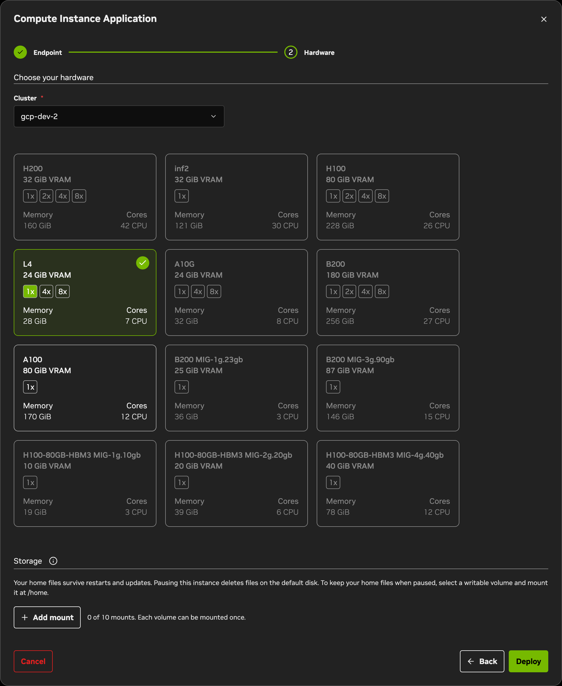
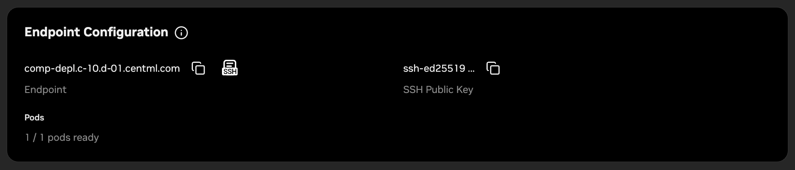
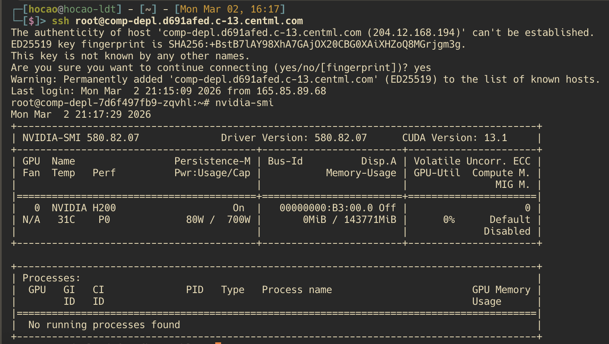

On-demand GPU instances with SSH access to run any GPU-accelerated workloads and let you run, test, and experiment with any AI application seamlessly.

## 1. Choose an image

Compute instances can run any container image. In the **Add or Select Image** field, type the name of an image from a container registry and set the **Container Tag**. For example, use image `ubuntu` with tag `24.04`, or image `nvcr.io/nvidia/pytorch` with tag `26.01-py3`. If your environment defines suggested images, they appear in the dropdown.

On full GPU instances, NVIDIA drivers are included via driver passthrough, so the GPU is accessible even from a minimal image like `ubuntu`. On MIG instances, NVIDIA drivers are **not** available yet. CUDA and framework libraries are not injected and must come from the image itself, so for GPU workloads pick an image that bundles them, like the [NVIDIA NGC](https://catalog.ngc.nvidia.com/containers) PyTorch image.

<Note>
Your image does not need an SSH server preinstalled. CCluster injects one at deploy time without modifying the image. The SSH server runs as the container's main process, so the image's own `ENTRYPOINT`/`CMD` is not executed. Connect over SSH to start your workloads.
</Note>

### Private registry images

For an image that requires authentication, choose **Image pull authentication → Registry credentials**. Select a saved entry in **Registry username**, or type a username and **Password or access token** directly. For NVIDIA NGC (`nvcr.io`), use the literal username `$oauthtoken` and your NGC API key as the password. See [Save NGC registry credentials](/resources/vault#example-nvidia-ngc-nvcrio) for the complete example. CCluster detects the registry from the image URL. Leave credentials empty for images that allow anonymous pulls.

Choose **Existing cluster pull secret** to use a secret managed by your cluster administrator. API deployments can also [reference an existing image pull secret](/resources/custom-image#use-an-existing-image-pull-secret) managed by your cluster administrator using `image_pull_secret_name`.

## 2. Configure access and deploy

Enter your SSH public key to configure access to the instance, select a GPU instance type, and click Deploy.

Optional settings on the create form:

- **Storage** — mount filesystem volumes or S3 buckets on the **Hardware** step. Mount a writable volume at `/home` to keep your home files when the instance is paused. See [Managing Storage](/resources/storage).
- **Enable logging** — collect container output and show it on the deployment **Logs** tab.
- **Annotations** — optional key/value metadata on the instance.

<Frame>
    
</Frame>

## 3. SSH into the instance

Once the instance is ready, navigate to the deployment details page. The **Endpoint Configuration** section displays:

- **Endpoint URL** — the hostname for your instance. Next to it are the copy button (copies the URL) and the SSH button (copies `ssh root@<endpoint_url>` so you can paste it directly into your terminal).

<Frame>
    
</Frame>

To connect, use the SSH command with the `root` user:

```bash showLineNumbers={false}
ssh root@<endpoint_url>
```

<Frame>
    
</Frame>

The instance authenticates you with the SSH public key you provided at deployment. You can also run one-off commands, transfer files, and forward TCP ports:

```bash showLineNumbers={false}
# Run a one-off command
ssh root@<endpoint_url> 'nvidia-smi'

# Copy files to and from the instance with scp or SFTP
scp ./train.py root@<endpoint_url>:/home/
scp root@<endpoint_url>:/home/results.csv .

# Forward a port from the instance to your local machine (TensorBoard in this example)
ssh -L 6006:localhost:6006 root@<endpoint_url>
```

SSH agent forwarding is supported. X11 forwarding is not supported.

The interactive shell depends on what your image provides:

| Image | Shell over SSH |
| --- | --- |
| Images with `bash` (e.g., Ubuntu, Debian, NGC images) | `bash` login shell |
| Images with only `sh` (e.g., Alpine) | `/bin/sh` |
| Images without a shell (e.g., distroless) | No interactive shell. SFTP file transfer still works |

The instance includes the libraries from your image. Additional packages can be installed with your preferred package manager.

### In-console Terminal

While the instance is **Active**, the deployment **Terminal** tab opens a shell in the browser without SSH from your machine. Use SSH (above) for `scp`/`SFTP` and port forwarding. See [Managing Deployments](/resources/managing-deployments) for Terminal availability, pause/resume, clone, and logs.

Compute deployments are revision-aware: spec edits create a new revision, and the **Detail** tab lists revisions so you can inspect them and roll back. See [Managing Deployments](/resources/managing-deployments#revisions-rollback-and-rollout).

## Profile GPU workloads

Nsight Compute, CUPTI metrics, and the GPU metrics in Nsight Systems read the GPU's performance counters. By default the NVIDIA driver allows that only for admin processes, and the tools report [`ERR_NVGPUCTRPERM`](https://developer.nvidia.com/ERR_NVGPUCTRPERM). CCluster-managed clusters load the driver with `NVreg_RestrictProfilingToAdminUsers=0`, so you can profile from a compute instance without extra privileges:

```bash showLineNumbers={false}
ncu -o report python train.py
```

To check a cluster's setting, run this on the instance. `RmProfilingAdminOnly: 0` means profiling is open to non-admin processes.

```bash showLineNumbers={false}
grep RmProfilingAdminOnly /proc/driver/nvidia/params
```

Nsight Systems CUDA tracing works either way. Only its GPU metrics (`--gpu-metrics-devices`) need the counters.

### Clusters your organization operates

If your organization runs its own cluster, your cluster administrator sets the parameter wherever the cluster installs the NVIDIA driver. It applies to every workload on the node, and it takes effect only after the driver reloads on each GPU node, which interrupts the GPU workloads running there.

#### Driver installed by the GPU Operator

Create a ConfigMap with the parameter in the GPU Operator's namespace (`gpu-operator` here):

```bash showLineNumbers={false}
kubectl create configmap kernel-module-params -n gpu-operator \
  --from-literal=nvidia.conf=NVreg_RestrictProfilingToAdminUsers=0
```

Point the driver at it in the GPU Operator's Helm values and upgrade the release. With the default upgrade policy, the GPU Operator then reloads the driver one node at a time, evicting GPU pods from each node first.

```yaml showLineNumbers={false}
driver:
  kernelModuleConfig:
    name: kernel-module-params
```

If you manage the driver with `NVIDIADriver` resources, set `spec.kernelModuleConfig.name` on each of them instead. The GPU Operator does not reload the driver when only a ConfigMap's contents change, so to change the parameters later, create a ConfigMap under a new name and point the configuration at it.

#### Driver included in the node image

Add the parameter to the driver's module options on each GPU node, for example when you build the node image:

```bash showLineNumbers={false}
echo 'options nvidia NVreg_RestrictProfilingToAdminUsers=0' > /etc/modprobe.d/nvidia-profiling.conf
```

The driver reads the option when it loads, so it takes effect after the node reboots. If your image loads the driver from the initramfs, rebuild the initramfs after adding the file.

<Note>
NVIDIA restricts the counters by default as a precaution for shared GPUs: on a GPU that several users share, the counters can reveal some of another process's activity. Workloads with whole GPUs only see their own work, so this only matters where users share a GPU through MIG or time-slicing.
</Note>


## What's next

<CardGroup cols={3}>
  <Card
    title="Managing Deployments"
    icon="fa-solid fa-sliders"
    href="/resources/managing-deployments"
  >
    In-console Terminal, logs, pause, and clone.
  </Card>
  <Card
    title="Managing Secrets"
    icon="fa-solid fa-key"
    href="/resources/vault"
  >
Store SSH keys and registry credentials for reuse across deployments
 </Card>
  <Card
    title="NVIDIA Dynamo"
    icon="fa-solid fa-diagram-project"
    href="/apps/dynamo"
  >
    Serve LLMs with disaggregated prefill/decode, autoscaling, and scale to zero.
 </Card>
</CardGroup>
