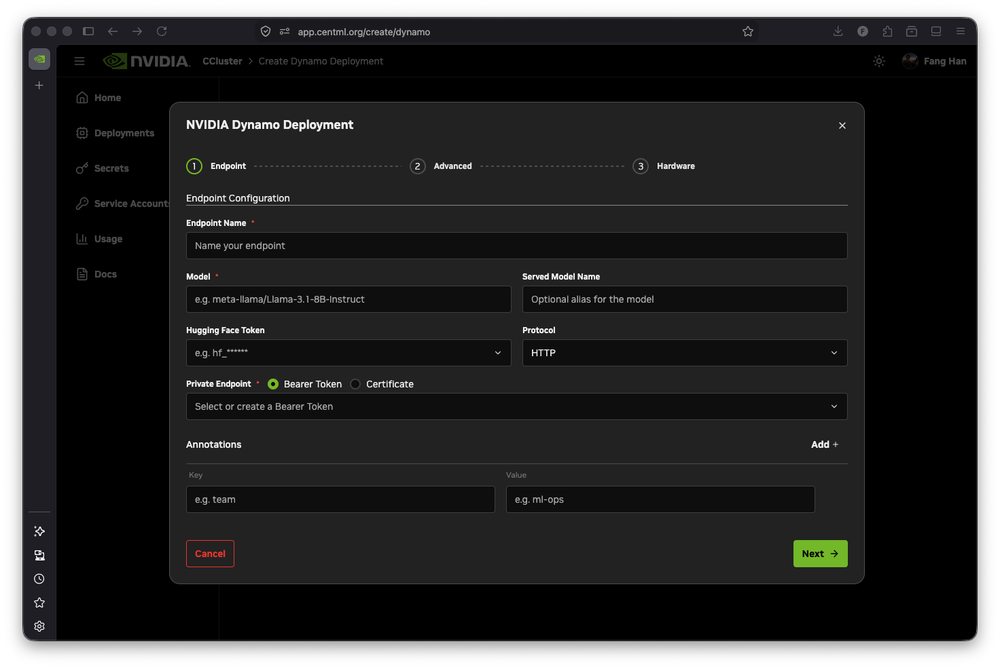
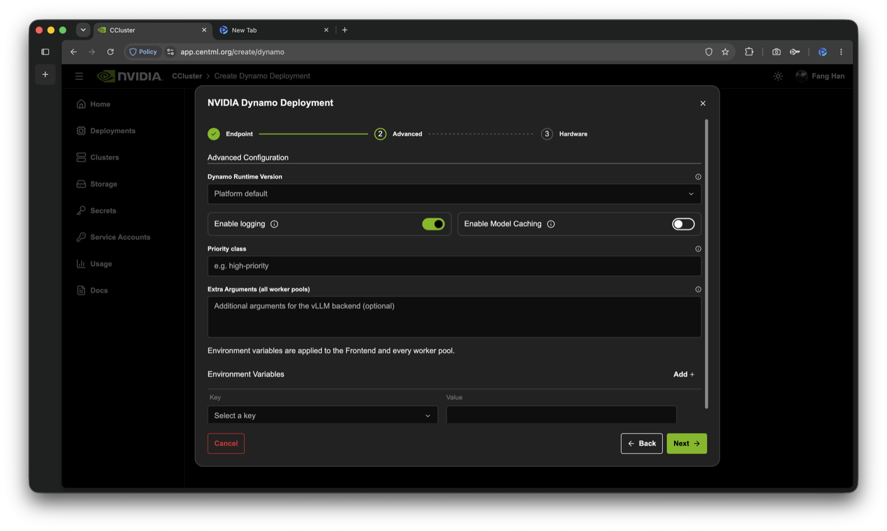
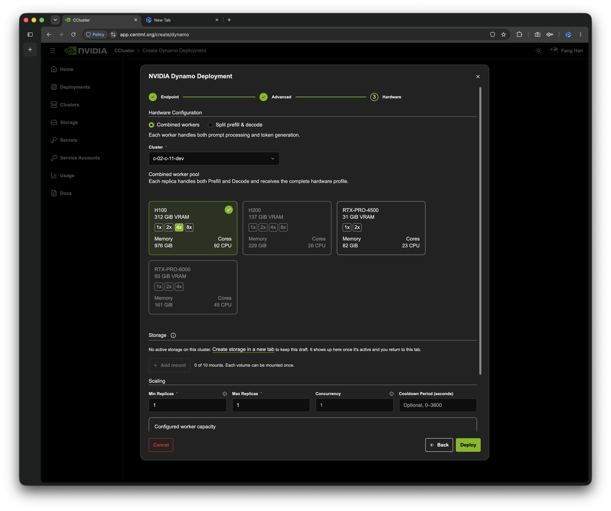

NVIDIA Dynamo deployments are backed by a Dynamo Frontend and GPU-powered vLLM workers. HTTP deployments expose an OpenAI-compatible API, while gRPC deployments expose the KServe v2 inference protocol. NVIDIA CCluster manages the Dynamo runtime, deployment lifecycle, TLS ingress, revisions, scaling configuration, status, and logs.

<Note>
NVIDIA Dynamo support is currently in beta. It is available only on clusters where the Dynamo operator is enabled. If **Dynamo** is not available when you create a deployment, contact your NVIDIA representative.
</Note>

The integration supports two serving topologies:

- **Aggregated** (**Combined workers** in the console) — each Worker performs both prompt processing and token generation. Aggregated Workers can use a fixed replica count, autoscale within a configured range, or scale to zero when idle.
- **Disaggregated** (**Split prefill & decode** in the console, a Preview feature) — separate Prefill and Decode pools perform prompt processing and token generation. The Frontend routes work between the pools, and Prefill transfers KV state to Decode. These pools currently use fixed replica counts.

Both topologies use one CPU-only **Frontend**. Every GPU worker replica consumes one complete instance of its selected hardware type. NVIDIA CCluster supplies the Dynamo runtime image, so you select the model, the hardware, and optionally a runtime version instead of providing a container image.

## Before you begin

Prepare the following:

- A Hugging Face model identifier, such as `Qwen/Qwen3-0.6B`.
- Access to the model on Hugging Face. For gated or private models, accept the model license and provide a Hugging Face token that can download it.
- A Bearer token or client certificate for endpoint authentication. Public, unauthenticated endpoints are not supported.
- Enough GPU capacity in the cluster for either the maximum aggregated Worker count or the combined fixed Prefill and Decode pools.

## 1. Configure the endpoint

From **New Deployment**, choose **Dynamo**. The **Endpoint** step contains the required serving settings:

- **Endpoint Name** — a unique name containing lowercase letters, numbers, and hyphens. It must begin with a lowercase letter, end with a letter or number, and be no more than 20 characters.
- **Model** — the Hugging Face model identifier loaded by the vLLM workers.
- **Served Model Name** — an optional alias clients can send in the OpenAI `model` field. If you leave it empty, use the Hugging Face model identifier.
- **Hugging Face Token** — required for gated and private models.
- **Protocol** — `HTTP` for the OpenAI-compatible API or `gRPC` for the KServe v2 inference protocol.
- **Private Endpoint** — select or create a Bearer token or client certificate.
- **Annotations** — optional key/value metadata applied to the deployment components.

<Tip>
For Bearer token and mTLS setup, see [Securing Endpoints](/resources/private). Do not place endpoint credentials in environment variables.
</Tip>

<Frame>
    
</Frame>

## 2. Configure runtime options

The **Advanced** step includes optional runtime and observability settings:

- **Dynamo Runtime Version** — the NVIDIA Dynamo vLLM runtime version the deployment runs. The list shows versions that NVIDIA CCluster has validated, and you can also type another published version tag. Leave it empty to use the platform default, which accounts for the target cluster and the KV transfer policy. Changing the version of an existing deployment restarts every component. When the deployment does not run the newest validated version, the **Detail** tab shows **Update Available**.
- **Enable logging** — enabled by default. Container output is collected and displayed in the deployment's **Logs** tab.
- **Enable Model Caching** — stores model files in a node-local persistent cache. Restarts and replicas scheduled on the same node can reuse the files instead of downloading them again.
- **Priority class** — an optional Kubernetes PriorityClass name for the deployment's pods. Leave it empty unless your cluster defines a PriorityClass you want these pods to use.
- **Extra Arguments (all worker pools)** — additional vLLM worker arguments, applied to every worker pool. During the beta, use this field only when directed by NVIDIA CCluster support; an unsupported value can prevent the worker from starting. Disaggregated deployments reject arguments that override the Prefill and Decode settings NVIDIA CCluster manages, such as `--kv-transfer-config`.
- **Environment Variables** — additional variables passed to the Frontend and every worker pool. Use shell-compatible names containing letters, numbers, and underscores, beginning with a letter or underscore. Names that NVIDIA CCluster manages, such as `DYN_HTTP_PORT` and `DYN_REQUEST_PLANE`, are rejected.

<Tip>
The Frontend uses KV-aware routing (`DYN_ROUTER_MODE=kv`) by default. To use another Dynamo router mode, such as `round-robin`, set `DYN_ROUTER_MODE` in **Environment Variables**. See [Using the Dynamo Frontend](https://docs.nvidia.com/dynamo/v1.5.1/kubernetes/kv-aware-routing/using-the-dynamo-frontend) for how KV-aware routing selects a worker.
</Tip>

<Frame>
    
</Frame>

## 3. Select the serving topology and hardware

In the **Hardware** step, choose a **Serving topology** and a cluster:

- **Combined workers** — aggregated serving with one worker pool. See [Aggregated workers](#aggregated-workers).
- **Split prefill & decode** — disaggregated serving with separate Prefill and Decode pools. See [Disaggregated serving](#disaggregated-serving).

You cannot change the serving topology or the cluster when you edit a deployment. To use a different topology, clone the deployment and choose it in the copy.

### Aggregated workers

Choose a GPU hardware type. The selection applies to each Worker replica: for example, if the selected hardware is `8 x H100`, every Worker uses one `8 x H100` instance.

Configure the worker count with these fields:

| Setting | Description |
| --- | --- |
| **Min Replicas** | Minimum number of GPU worker replicas. Set it to `0` to let the Workers scale to zero when idle; see [Scale to zero](#scale-to-zero). |
| **Max Replicas** | Maximum number of GPU worker replicas, at least `1`. Set it equal to **Min Replicas** for a fixed-size deployment. |
| **Concurrency** | Target number of active requests per worker used to calculate the desired worker replica count. Required when **Max Replicas** is greater than both `1` and **Min Replicas**. |
| **Cooldown Period** | Scale-down stabilization time in seconds, from `0` to `3600`. Defaults to `1800`. With **Min Replicas** set to `0`, it also controls how long the Workers stay up after the last request. |

<Note>
Set **Min Replicas** lower than **Max Replicas** to enable autoscaling. NVIDIA CCluster scales the Worker component within the configured range: between zero and one Worker based on whether the endpoint receives requests, and above one Worker based on active request concurrency.
</Note>

<Frame>
    
</Frame>

Make sure the cluster has enough capacity to run **Max Replicas** workers, each consuming one complete selected hardware instance. The **Configured worker capacity** summary shows the worker and accelerator range for your selection.

#### Scale to zero

With **Min Replicas** set to `0`, NVIDIA CCluster stops every Worker after the endpoint has been idle for slightly longer than the **Cooldown Period**, and the deployment status changes to **Scaled to zero**. The Frontend keeps running, so the endpoint stays reachable.

A request to a deployment that is scaled to zero wakes it, but the request is not held until a Worker is ready. Requests fail until a Worker has loaded the model, and HTTP requests receive a `404` response in that window, so clients should retry with backoff. A wake-up takes about as long as a normal Worker start, which can be several minutes for a large model that is not already cached. If no Worker starts after the first request, send another; every request that reaches the endpoint counts toward the wake-up.

Every request that passes endpoint authentication counts as activity, whatever its path. Health checks or monitoring that call the endpoint with valid credentials therefore wake the Workers or keep them running.

### Disaggregated serving

Disaggregated serving is a Preview feature. Prefill and Decode use fixed replica counts, and each replica receives its own hardware allocation. Configure both pools:

- **Prefill** — processes prompts and prepares KV cache state for Decode.
- **Decode** — generates output tokens after receiving KV cache state from Prefill.

Choose a hardware type and a replica count of at least `1` for each pool. **Use the same hardware profile for Prefill and Decode** is selected by default; clear it to choose a different hardware type for Decode. Both hardware types must be available in the selected cluster. Every replica consumes one complete hardware instance, so the deployment's GPU footprint is the sum of the two pools, as the **Configured worker capacity** summary shows.

**Require GPU Direct RDMA** (Beta) sets the KV transfer policy between Prefill and Decode. Leave it off for automatic transport selection, which allows TCP. Turn it on to require GPU-to-GPU transfer over RDMA with no TCP fallback; this requires an EFA-enabled AWS cluster and a compatible runtime. See [Understand KV transfer transport](#understand-kv-transfer-transport) before you turn it on.

Prefill and Decode pools do not autoscale, and they cannot scale to zero.

### Storage volumes

Both topologies can mount reusable volumes from the cluster in the **Storage** section of the **Hardware** step. Mounts apply to the Frontend and to every worker's main container, at the same paths. Volumes must belong to the deployment's creator. When you edit a deployment, removing a mount changes only the new revision; the volume and its data are kept.

Click **Deploy**. Model download and worker startup can take several minutes, especially for large models that are not already cached.

## 4. Create a disaggregated deployment with the API

You can also create a disaggregated deployment through the API. Send a `POST` request to `/deployments/dynamo` with `serving_mode` set to `disaggregated` and define both worker pools:

```json
{
  "name": "dynamo-pd",
  "cluster_id": 123,
  "model": "Qwen/Qwen3-0.6B",
  "serving_mode": "disaggregated",
  "worker_pools": {
    "prefill": {
      "hardware_instance_id": 456,
      "min_replicas": 1,
      "max_replicas": 1
    },
    "decode": {
      "hardware_instance_id": 789,
      "min_replicas": 2,
      "max_replicas": 2
    }
  },
  "communications": {
    "kv_transfer": {
      "policy": "allow_tcp"
    }
  },
  "endpoint_bearer_token": "<endpoint-bearer-token>",
  "enable_logging": true
}
```

Each pool needs a `hardware_instance_id` and a fixed size: set `min_replicas` and `max_replicas` to the same value, at least `1`. The older per-pool `replicas` field is deprecated but still accepted. The Prefill and Decode pools can use the same GPU hardware profile or different profiles, but both profiles must be available in the selected cluster. Every replica consumes one complete hardware instance, so the deployment's GPU footprint is the sum of the Prefill and Decode pool footprints.

The `endpoint_bearer_token` in this request protects the deployed inference endpoint. It is separate from the credential used to authenticate the request to the NVIDIA CCluster API.

`communications.kv_transfer.policy` selects the KV transfer policy: `allow_tcp`, the console default, or `require_gpu_direct_rdma`. If you omit `communications`, NVIDIA CCluster uses its default NIXL configuration, which also allows TCP. To pin a runtime version, set `runtime_version` to a Dynamo runtime version tag; otherwise NVIDIA CCluster selects the platform default for the cluster and policy.

Prefill and Decode pools are fixed-size in the current release and do not autoscale independently. Do not set `concurrency` or `cooldown_period` on the pools, and do not include the aggregated top-level fields `hardware_instance_id`, `min_replicas`, `max_replicas`, `concurrency`, or `cooldown_period` in a disaggregated request. Use `worker_pools` from `GET /deployments/dynamo/{deployment_id}` as the source of truth for its hardware and replica configuration.

### Understand KV transfer transport

NVIDIA CCluster configures `NixlConnector` on both Prefill and Decode workers. NIXL is the logical KV transfer connector; the deployment's KV transfer policy decides which NIXL backend carries the KV cache:

| Policy | Console setting | KV transfer path |
| --- | --- | --- |
| `allow_tcp` | **Require GPU Direct RDMA** off (default) | NIXL uses UCX, which selects lanes and transports from the resources visible to both pods. TCP is allowed, and no RDMA or EFA device is requested. |
| `require_gpu_direct_rdma` | **Require GPU Direct RDMA** on (Beta) | NIXL uses libfabric over AWS EFA and transfers KV cache directly between GPU buffers. TCP fallback is disabled. |

#### Automatic transport selection

With `allow_tcp`, or when `communications` is omitted, the deployment layout uses separate pod IPC namespaces, does not request an RDMA or EFA device, and does not guarantee same-node placement. NIXL does not by itself guarantee that a deployment uses NVLink, CUDA IPC, RDMA, or EFA. When it uses UCX, UCX selects the concrete lanes and transports based on the resources visible to both pods and the capabilities provisioned on the cluster.

In a live validation with one Prefill and one Decode pod placed on the same 8×B200 node, UCX reported `rma_am(tcp/eth0)` and other TCP lanes over `eth0`; no RDMA or CUDA-IPC lane was selected. The KV transfer completed successfully, but this was a transport correctness check rather than a performance benchmark.

<Note>
TCP KV transfer adds overhead and can reduce the expected latency or throughput benefit of disaggregated serving. Do not infer the active transport from the GPU model or same-node placement alone. Measure the selected transport on your target cluster before making performance assumptions, and contact your NVIDIA representative if your workload requires an accelerated cross-pod KV path.
</Note>

With logging enabled, inspect the Prefill and Decode logs for UCX backend and lane output and for KV transfer metrics. Do not force `UCX_TLS` when establishing a baseline because that override changes transport selection.

#### Require GPU Direct RDMA

`require_gpu_direct_rdma` is available only on EFA-enabled AWS EKS clusters that expose EFA devices to pods through Kubernetes dynamic resource allocation (DRA). Requests for clusters on other cloud providers are rejected, and on an AWS cluster without DRA-managed EFA devices the workers cannot be scheduled. With this policy:

- Each Prefill and Decode worker requests one EFA device. A worker that cannot get one waits to be scheduled instead of falling back to TCP.
- All workers of the deployment run in the same availability zone, because EFA traffic cannot cross zones.
- The workers need an EFA-capable runtime. Leave **Dynamo Runtime Version** empty to use the platform's EFA runtime, or choose a version that supports EFA.
- NVIDIA CCluster manages the libfabric and NIXL settings, so environment variables whose names start with `FI_` or `NIXL_`, as well as `LD_LIBRARY_PATH` and `LD_PRELOAD`, are rejected. `FI_LOG_LEVEL`, `FI_LOG_PROV`, and `NIXL_LOG_LEVEL` remain available for diagnostics.

The KV transfer charts on the **Usage** tab show transfer activity for both policies, but they do not verify which transport carried it.

## 5. Monitor the deployment

The deployments list and revision table report Dynamo pods by component instead of combining them into one replica count:

- **Frontend** — the request-routing component. A standard deployment has one Frontend pod.
- **Worker** — the GPU-backed vLLM replicas in an aggregated deployment.
- **Prefill** — the GPU-backed prompt-processing replicas in a disaggregated deployment.
- **Decode** — the GPU-backed token-generation replicas in a disaggregated deployment.

For example, `Frontend (1 / 1 observed pods ready)` and `Worker (2 / 2 observed pods ready)` describe a ready aggregated deployment. `Frontend (1 / 1 observed pods ready)`, `Prefill (1 / 1 observed pods ready)`, and `Decode (2 / 2 observed pods ready)` describe a ready disaggregated deployment. The overall deployment can remain not ready when the Frontend is unhealthy, even if all workers are running, because the endpoint cannot accept traffic without it.

Open the deployment to access:

- **Detail** — endpoint, model, runtime version, hardware, scaling configuration, and revision history. The **Serving Topology** panel shows the serving mode, component readiness, the configured capacity of each worker pool, and, for disaggregated deployments, the requested KV transfer policy.
- **Logs** — logs for a selected component pod and revision. Logs are available only for revisions with logging enabled.
- **Terminal** — an interactive shell for an active deployment.
- **Usage** — Frontend time to first token, time per output token, request duration, output throughput, request outcomes, and queue depth per worker pool; worker GPU utilization and memory, running requests, and KV cache occupancy; and, for disaggregated deployments, KV transfer throughput, duration, completion rate, and failure rate.

<Note>
On an aggregated deployment, changing **Min Replicas** or **Max Replicas** scales the running deployment in place and **does not create a new revision**. Editing the spec (model, protocol, extra arguments, and similar), changing the hardware, or resizing a disaggregated Prefill or Decode pool creates a new revision. See [Managing Deployments](/resources/managing-deployments) for Terminal, pause/resume, clone, and the shared revision model.
</Note>

Editing a Dynamo deployment creates a new revision and starts an operator-managed rolling update. When you edit an Active aggregated deployment, you can also set **Max Unavailable** and **Max Surge** for the worker rollout. Changing **Dynamo Runtime Version** restarts every component, including the Frontend. You can inspect historical revision status and logs, clone a deployment, or roll back to an earlier revision. Pausing or resuming the whole deployment is supported; pausing only an in-progress Dynamo rollout is not.

The console's **Edit** and **Clone** flows support both topologies. An edit keeps the deployment's serving topology and cluster; clone the deployment to change either.

## 6. Call the endpoint

For a Bearer-protected HTTP deployment, copy the endpoint hostname and Bearer token from the **Detail** tab. Send requests to the OpenAI-compatible chat completions endpoint:

```bash showLineNumbers={false}
curl "https://<endpoint_url>/v1/chat/completions" \
  -H "Authorization: Bearer <your_bearer_token>" \
  -H "Content-Type: application/json" \
  -d '{
    "model": "<model-or-served-model-name>",
    "messages": [
      {
        "role": "user",
        "content": "Explain why low-latency inference matters."
      }
    ],
    "max_tokens": 128,
    "stream": false
  }'
```

For a certificate-protected endpoint, configure your HTTP client with the downloaded client certificate instead of the `Authorization` header. See [Securing Endpoints](/resources/private).

If you selected `gRPC`, connect to `<endpoint_url>:443` with TLS and use Dynamo's KServe v2 `ModelInfer` or `ModelStreamInfer` API. This is different from the direct vLLM gRPC API used by General Inference deployments. See the [NVIDIA Dynamo KServe gRPC frontend guide](https://docs.nvidia.com/dynamo/latest/components/frontend/frontend-guide) for the protocol and [Securing Endpoints](/resources/private) for authentication.

## Current scope

The beta integration currently supports:

- Aggregated serving with fixed-size Workers, Worker autoscaling between the configured minimum and maximum replica counts, and scale to zero.
- Disaggregated serving (Preview) with independent, fixed-size Prefill and Decode pools, created from the console or the API, and NIXL KV transfer that either allows TCP or, on EFA-enabled AWS EKS clusters, requires GPU Direct RDMA (Beta).
- HTTP OpenAI-compatible and KServe gRPC endpoints.
- Bearer token or mTLS endpoint protection.
- Revision-aware status, logs, rollback, editing, and cloning for both topologies.
- A selectable Dynamo runtime version.

The current integration has a single Frontend and does not expose Frontend high availability, independent Prefill or Decode autoscaling, scale to zero for disaggregated pools, coordinated or guaranteed same-node placement, an NVLink or CUDA IPC KV path, an accelerated KV path outside EFA-enabled AWS EKS clusters, custom Dynamo runtime images, or config-file mounts. For Dynamo architecture and features outside the NVIDIA CCluster integration, see the [NVIDIA Dynamo documentation](https://docs.nvidia.com/dynamo/latest/).

## What's next

<CardGroup cols={2}>
  <Card
    title="Managing Deployments"
    icon="fa-solid fa-sliders"
    href="/resources/managing-deployments"
  >
    Terminal, pause, clone, revisions, and replica scaling.
  </Card>
  <Card
    title="NVIDIA Dynamo Frontend"
    icon="fa-solid fa-diagram-project"
    href="https://docs.nvidia.com/dynamo/v1.5.1/knowledge-base/modular-components/frontend/overview"
  >
    Review Dynamo's OpenAI-compatible HTTP and KServe gRPC interfaces.
  </Card>
</CardGroup>
