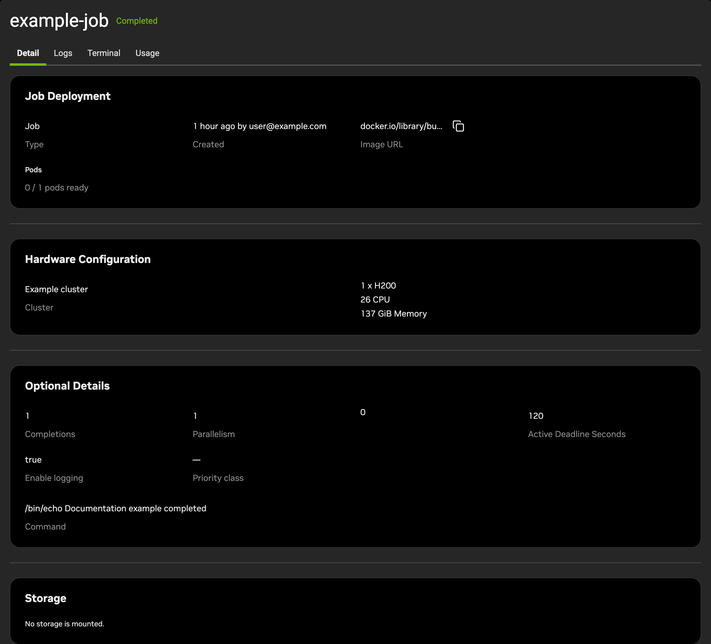

Jobs let you run any containerized workload as a **batch task** that runs to completion — model training, fine-tuning, data preprocessing, evaluation, or any one-off GPU job. Unlike inference or LLM deployments, jobs are batch workloads with **no endpoint or ingress**: they start, run your container until it finishes (or fails), and then stop. CCluster runs your container as a Kubernetes Job, so you can control how many times it runs, how many run in parallel, and how failures are retried.

## 1. Configure your job

Under the **Job Information** section, provide the core details for your workload:

- **Job Name** — a unique name for the job. It must start with a lowercase letter, contain only lowercase letters, digits, or hyphens (`-`), end with an alphanumeric character, and be at most 20 characters.
- **Container Image URL** — the container image to run (e.g., `nvcr.io/nvidia/base/ubuntu`).
- **Container Tag** — the image tag (e.g., `latest`).
- **Image pull authentication** — for private images, choose **Username and password** and select **Image Registry Credentials** saved in [Secrets](/resources/vault), or choose **Existing cluster pull secret** and enter the **Cluster pull secret name** that your cluster administrator manages. Leave it unset for public images. API deployments can also [reference an existing image pull secret](/resources/custom-image#use-an-existing-image-pull-secret) using `image_pull_secret_name`.

## 2. Set optional details

In the **Advanced** step, tune how the job executes. All of these fields are optional and fall back to sensible defaults.

- **Completions** — the number of pods that must complete successfully for the job to be considered done. Defaults to `1`. Use a value greater than `1` for indexed, multi-pod batch work.
- **Parallelism** — the maximum number of pods that run at the same time. Defaults to `1` and must be **less than or equal to Completions**.
- **Backoff Limit** — the number of retries before the job is marked as failed. Defaults to `3` and must be `0` or greater.
- **Active Deadline Seconds** — the maximum time (in seconds) the job may run before it is terminated. Must be `1` or greater. Leave empty for no deadline.
- **Command** — the entrypoint command and arguments for the container (e.g., `/bin/sh -c python3 "train.py"`). If left empty, the image's default entrypoint is used.
- **Enable logging** — toggle to collect and view logs from the job's pods.
- **Environment variables** — pass additional environment variables to the container. Select saved values from [Secrets](/resources/vault) where you can.
- **Annotations** — attach custom key/value metadata to the job.
- **Config file** — mount a file into the container. Provide **Filename**, **Mount Path (directory)**, and **File Content**. Use this for startup scripts or small configs your command can read.

<Note>
The environment variable names `JOB_COMPLETION_INDEX` and `JOB_COMPLETIONS` are reserved by the platform and cannot be used for your own variables. CCluster runs jobs in **indexed** completion mode and automatically injects both variables into every replica so each one can determine which slice of work it owns:

- **`JOB_COMPLETION_INDEX`** — the unique, zero-based index assigned to each replica, ranging from `0` to `Completions - 1`. Use it to partition or shard work across replicas (for example, to pick which data split a replica processes).
- **`JOB_COMPLETIONS`** — the total number of completions configured for the job (the **Completions** value). It is the same on every replica, letting each one know the total size of the pool.
</Note>

<Tip>
For building and deploying your own custom container image on NVIDIA CCluster, see [Deploying Custom Models](/resources/custom-image).
</Tip>

## 3. Select the cluster and hardware

Choose the regional cluster and GPU hardware instance that best fits your workload, then click **Deploy**. NVIDIA CCluster provides several managed clusters and GPU instance types to run your job on. To share data between the pods of a job or keep results after the job ends, add a mount in the **Storage** section; the mount applies to every pod of the job. See [Managing Storage](/resources/storage).

<Tip>
You can integrate your own private cluster into CCluster through bring-your-own-infrastructure support. To get started, open a support request through your NVIDIA CCluster support channel.
</Tip>

## 4. Monitor your job

Once created, your job appears in the deployments listing view alongside its current status. Click into the job to view its details page, including per-pod status and, when **Enable logging** is turned on, the logs from each pod. While pods are running, the **Terminal** tab opens an in-browser shell. Jobs can be paused and resumed from the details page, but they are not revision-aware and have no replica autoscaling. See [Managing Deployments](/resources/managing-deployments).

<Frame>
    
</Frame>

<Warning>
Pausing a job deletes its pods, and resuming starts the job again from the beginning. Completed work and in-memory progress are not preserved, so work can run again. To keep progress across a pause, checkpoint in your application and write the checkpoints to persistent storage. See [Managing Storage](/resources/storage).
</Warning>

Because jobs are batch workloads, there is no endpoint to call — the job runs until your container exits. A job is considered complete once the requested number of **Completions** finish successfully, and failed pods are retried up to the **Backoff Limit** (or until the **Active Deadline Seconds** is reached).

## What's next

<CardGroup cols={3}>
  <Card
    title="Managing Deployments"
    icon="fa-solid fa-sliders"
    href="/resources/managing-deployments"
  >
    Follow logs and use the in-console Terminal while the job is running.
  </Card>
  <Card
    title="Deploying Custom Models"
    icon="fa-solid fa-screwdriver-wrench"
    href="/resources/custom-image"
  >
    Learn how to build and deploy your own custom container images.
  </Card>
  <Card
    title="Compute Instance"
    icon="fa-solid fa-microchip"
    href="/apps/compute"
  >
    Launch an on-demand GPU instance with SSH access for interactive work.
  </Card>
</CardGroup>
