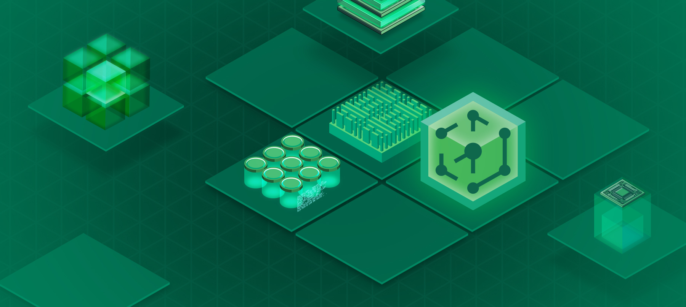
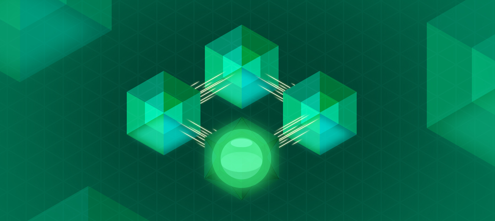
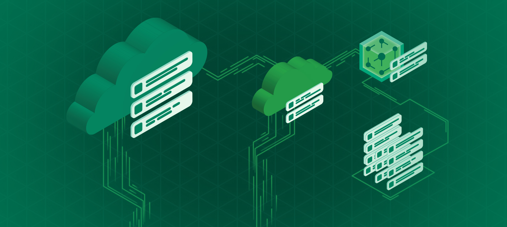

NVIDIA CCluster is an all-in-one infrastructure solution that empowers users to effortlessly build, deploy, and integrate AI applications with guaranteed best performance and lowest cost. We offer the following services:

| Turnkey GenAI deployments | Deploy any model | Deploy anywhere |
| --- | --- | --- |
|  |  |  |
| Access our application catalog featuring pre-packaged pipelines for common GenAI applications. | Deploy any model, any hardware with guaranteed reliability and scalability. | Deploy on your own cloud, on-premises, or on NVIDIA-managed infrastructure. |

## How to get started?

<Card title="A Quickstart Guide" icon="fa-solid fa-rocket" href="/home/quickstart">
  The first steps to help you get started with the NVIDIA CCluster.
</Card>
