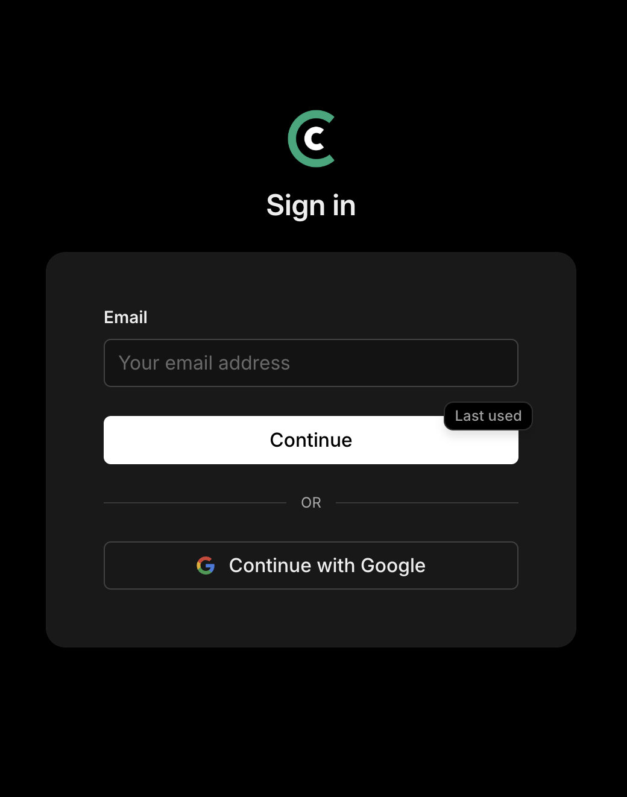
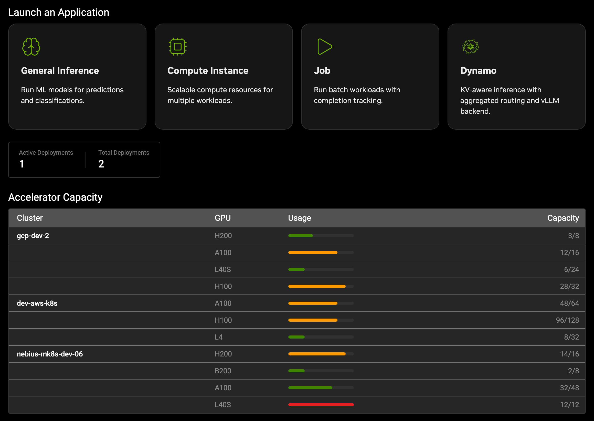

NVIDIA CCluster provides general inference, NVIDIA Dynamo LLM serving, compute instances, and batch jobs — all backed by optimized infrastructure.

No need to worry about GPU provisioning, scaling, or maintenance — just log in and deploy.

## 1. Log into the NVIDIA CCluster
To get started, sign in to the NVIDIA CCluster console using the access details provided by your NVIDIA team.

<Frame>
    
</Frame>

Once logged in, you will see the NVIDIA CCluster console home page, as shown below.

<Frame>
    
</Frame>

## 2. Create a bearer token
Endpoints are never public — every request must authenticate with a Bearer token or a client certificate. To interact with NVIDIA CCluster endpoints programmatically, generate a Bearer Token by following the [Managing Secrets](/resources/vault) documentation. For all protection options, see [Securing Endpoints](/resources/private).

## 3. Deploy your first model
Choose the deployment type that fits your use case:

- **[NVIDIA Dynamo](/apps/dynamo)** — Deploy protected LLM endpoints with aggregated or disaggregated prefill/decode serving, autoscaling, and scale to zero.
- **[General Inference](/apps/inference)** — Deploy custom containerized models on NVIDIA-managed infrastructure.
- **[Compute](/apps/compute)** — Provision GPU compute instances for training and fine-tuning.
- **[Batch Jobs](/apps/jobs)** — Run containerized workloads to completion.

## Additional support: billing, sales, and/or technical

For access, billing, sales, or technical assistance, contact your NVIDIA representative or your organization's designated support contact.

## What's next

<CardGroup cols={3}>
  <Card
    title="NVIDIA Dynamo"
    icon="fa-solid fa-diagram-project"
    href="/apps/dynamo"
  >
    Serve LLMs with disaggregated prefill/decode, autoscaling, and scale to zero.
 </Card>
  <Card
    title="Deploying Custom Models"
    icon="fa-solid fa-screwdriver-wrench"
    href="/resources/custom-image"
  >
    Learn how to build your own containerized inference engines and deploy them on the NVIDIA CCluster.
 </Card>
  <Card
    title="Clients"
    icon="fa-solid fa-terminal"
    href="/clients/setup"
  >
    Learn how to interact with the NVIDIA CCluster programmatically
  </Card>
</CardGroup>
