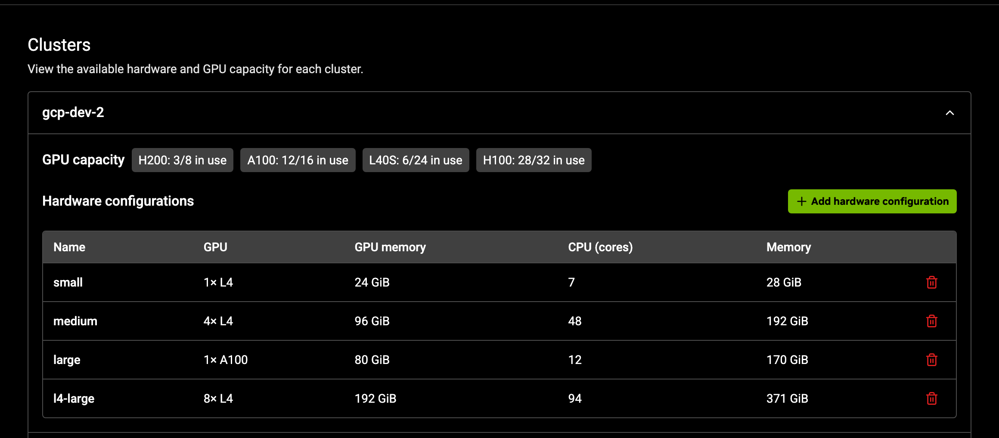
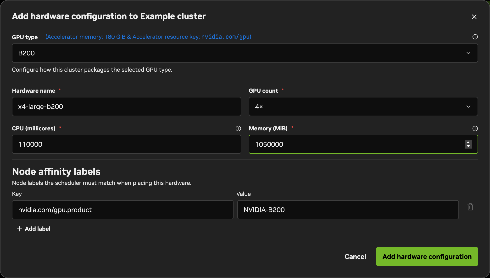

A **hardware instance** describes a class of hardware — GPU type, GPU count, CPU, and memory — that is available for deployments within a [cluster](/apps/compute). The [Python SDK](/clients/sdk) lets you list the hardware instances you have access to, and (with the right permissions) create and delete them.

<Note>
Creating and deleting hardware instances requires admin privileges (`PERM_ADMIN_MANAGE_HARDWARE`) on your NVIDIA CCluster organization. Listing hardware instances does not require admin privileges.
</Note>

## View clusters and capacity in the console

Select **Clusters** from the sidebar to see every cluster available to your organization. Each cluster is a collapsible row that shows:

- **GPU capacity** — one chip per GPU type, such as `H200: 3/8 in use`.
- **Hardware configurations** — a table of the hardware instances you can deploy on the cluster, with **Name**, **GPU** (count and type), **GPU memory**, **CPU (cores)**, and **Memory**.

<Frame>
    
</Frame>

The **Accelerator Capacity** table on the console home page shows the same capacity data, with a usage bar per GPU type. The bar is green below 70%, amber from 70% to 89%, and red at 90% or more.

<Note>
**In use** counts the GPUs that running workloads have requested, not how busy those GPUs are. A cluster whose capacity cannot be read shows "Capacity data is not currently available".
</Note>

When you create a deployment, the **Hardware** step shows one card per GPU type for the cluster you select, with its GPU memory, system memory, CPU count, and the GPU counts (1x, 2x, 4x, 8x) that are available. Cards for GPU types that the selected cluster does not offer are greyed out. If a cluster is closed to new deployments, creating one fails with "Cluster does not allow new deployments".

### Add or remove hardware configurations

Administrators can manage a cluster's hardware catalog from the same page. Click **Add hardware configuration** in a cluster and fill in:

- **GPU type** — chosen from the shared hardware catalog. It sets the GPU memory shown for the configuration.
- **Hardware name** — for example `x4-large-b200`.
- **GPU count** — `1`, `2`, `4`, or `8`.
- **CPU (millicores)** — `1000` millicores is one CPU core.
- **Memory (MiB)** — `1024` MiB is one GiB.
- **Node affinity labels** — at least one key and value that the scheduler must match when it places the hardware. Selecting a GPU type pre-fills `nvidia.com/gpu.product`.

<Frame>
    
</Frame>

To remove a configuration, click the trash button in its row and confirm **Delete**. This removes the configuration from the cluster catalog so new deployments cannot use it. Existing deployments are not deleted.

Adding and deleting hardware requires the `PERM_ADMIN_MANAGE_HARDWARE` permission. The **Add hardware configuration** button is visible to everyone in the console, but the request is rejected for users without that permission.

## Manage hardware with the Python SDK

The rest of this page shows how to list, create, and delete hardware instances with the [Python SDK](/clients/sdk).

## Prerequisites

Install the SDK and authenticate before running any of the examples below. For unattended use in CI or automation, authenticate with a [service account](/resources/service-accounts) by setting `CENTML_SERVICE_ACCOUNT_ID` and `CENTML_SERVICE_ACCOUNT_SECRET`. Interactive development can use `centml login` instead — see [Client Setup](/clients/setup).

## List hardware instances

`get_hardware_instances` returns the hardware instances you have access to. Pass an optional `cluster_id` to restrict the results to a single cluster.

```python
from centml.sdk.api import get_centml_client

with get_centml_client() as client:
    clusters = {c.id: c for c in client.get_clusters().results}
    instances = client.get_hardware_instances()

for hw in instances:
    cluster = clusters.get(hw.cluster_id)
    cluster_name = cluster.display_name if cluster else f"cluster {hw.cluster_id}"
    print(f"{hw.name} ({cluster_name}): {hw.num_gpu}x {hw.gpu_type}, "
          f"{hw.cpu} CPU, {hw.memory} memory")
```

Each returned hardware instance exposes fields such as `id`, `name`, `cluster_id`, `gpu_type`, `num_gpu`, `cpu`, and `memory`.

## Create a hardware instance

Use `create_hardware_instance` with a `CreateHardwareInstanceRequest` to register a new hardware instance under a cluster.

```python
from centml.sdk import CreateHardwareInstanceRequest
from centml.sdk.api import get_centml_client

request = CreateHardwareInstanceRequest(
    cluster_id=1,
    name="h100-8x",
    gpu_type="H100",
    num_gpu=8,
    cpu=64000,
    memory=128000,
    accelerator_resource_key="nvidia.com/gpu",
    node_affinity_labels={"gpu": "h100"},
    accelerator_memory=80000,
)

with get_centml_client() as client:
    instance = client.create_hardware_instance(request)

print(f"Created hardware instance '{instance.name}' with ID {instance.id}")
```

The `CreateHardwareInstanceRequest` accepts the following fields:

| Field | Description |
|-------|-------------|
| `cluster_id` | ID of the cluster the hardware instance belongs to. |
| `name` | Human-readable name for the hardware instance. |
| `gpu_type` | GPU model, e.g. `"H100"`. |
| `num_gpu` | Number of GPUs per instance. |
| `cpu` | CPU allocation (in millicores). |
| `memory` | Memory allocation (in MB). |
| `accelerator_resource_key` | Kubernetes resource key for the accelerator, e.g. `"nvidia.com/gpu"`. |
| `node_affinity_labels` | Node affinity labels used to schedule onto the correct nodes, e.g. `{"gpu": "h100"}`. |
| `accelerator_memory` | GPU memory per accelerator (in MB). |

## Delete a hardware instance

Use `delete_hardware_instance` with the hardware instance's ID to remove it.

```python
from centml.sdk.api import get_centml_client

with get_centml_client() as client:
    client.delete_hardware_instance(123)
```

<Tip>
A full runnable example is available at [`examples/sdk/manage_hardware_instances.py`](https://github.com/CentML/centml-python-client/blob/main/examples/sdk/manage_hardware_instances.py).
</Tip>

## What's next

<CardGroup cols={2}>
  <Card
    title="Python SDK Reference"
    icon="fa-brands fa-python"
    href="/clients/sdk"
  >
    Programmatically manage your deployments with the NVIDIA CCluster SDK.
  </Card>
  <Card
    title="Compute Deployments"
    icon="fa-solid fa-microchip"
    href="/apps/compute"
  >
    Deploy workloads onto the clusters your hardware instances belong to.
  </Card>
</CardGroup>
