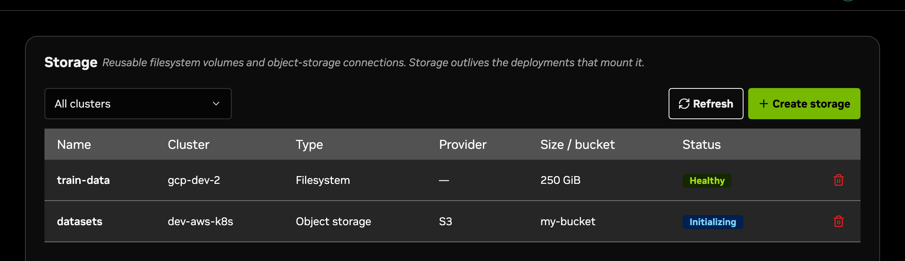
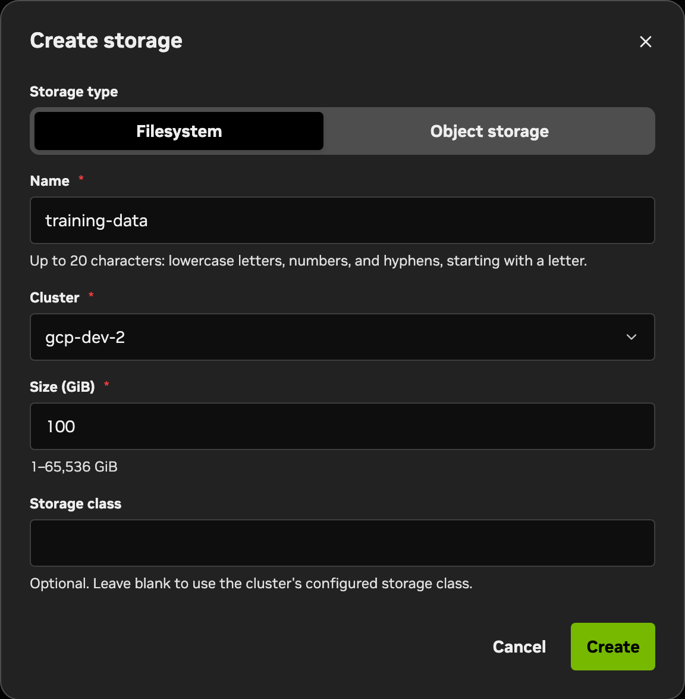
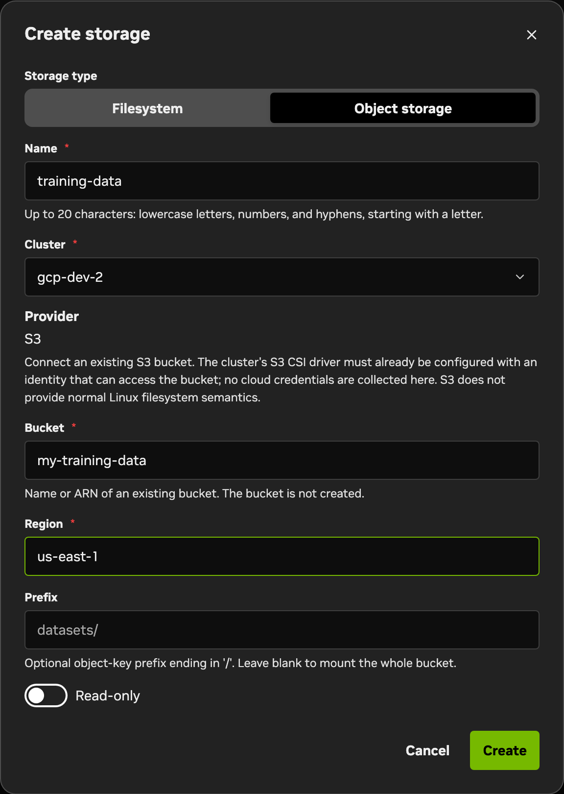

**Storage** gives your deployments data that outlives them: model weights, datasets, checkpoints, and home directories. Storage is created once, belongs to one cluster, and can be mounted into [Compute](/apps/compute), [Batch Jobs](/apps/jobs), [General Inference](/apps/inference), and [NVIDIA Dynamo](/apps/dynamo) deployments on that cluster.

There are two storage types:

| Type | What it is | Good for |
| --- | --- | --- |
| **Filesystem** | A persistent volume you size yourself. Every deployment that mounts it shares the same files (`ReadWriteMany` access). | Datasets, checkpoints, model caches, persistent home directories |
| **Object storage** | A connection to an **existing** Amazon S3 bucket, mounted through the cluster's S3 CSI driver. | Reading large datasets that already live in a bucket |

<Note>
S3 mounts do not provide normal Linux filesystem semantics. Use a **Filesystem** volume for workloads that need them.
</Note>

## 1. Create storage

Select **Storage** from the sidebar, then click **Create storage**.

<Frame>
    
</Frame>

Choose a **Storage type**, then fill in the fields.

### Filesystem

<Frame>
    
</Frame>

- **Name** — up to 20 characters: lowercase letters, numbers, and hyphens, starting with a letter. A name must be unique per user and cluster.
- **Cluster** — the cluster that hosts the volume. A volume can only be mounted by deployments on this cluster.
- **Size (GiB)** — a whole number from `1` to `65536`. The default is `100`.
- **Storage class** — optional. Leave it blank to use the cluster's configured storage class.

### Object storage

<Frame>
    
</Frame>

- **Name** and **Cluster** — as above.
- **Provider** — `S3`.
- **Bucket** — the name or ARN of an existing bucket. NVIDIA CCluster does not create the bucket.
- **Region** — the bucket's region, for example `us-east-1`.
- **Prefix** — optional object-key prefix that ends in `/`. Leave it blank to mount the whole bucket.
- **Read-only** — turn on to make every mount of this connection read-only.

No cloud credentials are entered in the console. The cluster's S3 CSI driver must already be configured with an identity that can access the bucket, so ask your cluster administrator if mounts cannot read the bucket.

<Warning>
You cannot resize or edit a volume after you create it, and the storage class is fixed. Create a new volume if you need a different size or class.
</Warning>

## 2. Check the status

The **Status** column shows the live state of the storage:

| Status | Meaning |
| --- | --- |
| **Healthy** | The storage is provisioned and bound. |
| **Initializing** | Provisioning is not finished. Some storage classes wait for the first deployment that mounts the volume, so this can be normal until then. You can still select the volume. |
| **Error** | Provisioning failed or the storage was lost. Open the volume for the error message, then delete it and create it again. |
| **Missing** | The storage resources are missing from the cluster. Delete the volume and create it again. |
| **Unknown** | The status could not be determined. |

Click a row to open the volume details: cluster, size and storage class (or provider, bucket, region, prefix, and access), access mode, ID, and creation time. Use **Filter by cluster** to narrow the list. The list shows storage for your whole organization, but you can only mount volumes that you created.

## 3. Mount storage in a deployment

The **Hardware** step of the Compute, Job, Inference, and Dynamo create and edit forms has a **Storage** section. It appears after you select a cluster. Click **Add mount** and set:

- **Volume** — an active volume on the same cluster. If none are listed, create storage first.
- **Mount path** — the absolute path in the container, for example `/data`.
- **Read-only** — mount the volume read-only. A read-only S3 connection is always mounted read-only.

Rules for mounts:

- A deployment can have up to **10** mounts, and each volume can be mounted **once** per deployment.
- Mount paths must be absolute, unique, not `/`, and must not contain `..`. Paths that the platform uses itself, such as `/dev/shm`, are rejected.
- You can only mount volumes you created, on the deployment's own cluster. If you change the cluster, mounts for other clusters are removed.
- Mounts apply to the compute instance, to every pod of a job, to the inference application container, or to the Dynamo Frontend and every worker.
- When you edit a deployment and remove a mount, only the new revision changes. The volume and its data are kept.

### Keep your Compute home directory

A Compute instance's SSH home folder is `/root`. Files in it survive restarts and updates, but pausing the instance deletes files on the default disk. To keep them across a pause, mount a **writable** volume at `/home` (or at `/root`). A volume mounted at `/home` gets its own sub-directory per deployment, and the files from the image are copied in the first time. A volume mounted directly at `/root` is used as it is. Changing volumes does not copy existing files.

## 4. Delete storage

Click the trash button on a row, and then **Delete**.

- For a **Filesystem** volume, files may be permanently deleted, depending on the storage class's reclaim policy. Retention is not guaranteed.
- For **Object storage**, only the mount resources are removed from the cluster. Objects in the bucket are left intact.
- You can delete storage that you created. Organization administrators with the volume-management permission can delete any volume.

<Warning>
You cannot delete storage while any retained revision of a deployment that still exists uses it. That includes older revisions, paused deployments, and completed jobs. Removing the mount from the current revision does not release older revisions. Delete those deployments first.
</Warning>

## What's next

<CardGroup cols={3}>
  <Card
    title="Compute Instance"
    icon="fa-solid fa-microchip"
    href="/apps/compute"
  >
    Persist your home directory across pauses.
  </Card>
  <Card
    title="Batch Jobs"
    icon="fa-solid fa-list-check"
    href="/apps/jobs"
  >
    Share datasets and results across job pods.
  </Card>
  <Card
    title="Managing Deployments"
    icon="fa-solid fa-sliders"
    href="/resources/managing-deployments"
  >
    Pause, resume, edit, and roll back deployments.
  </Card>
</CardGroup>
