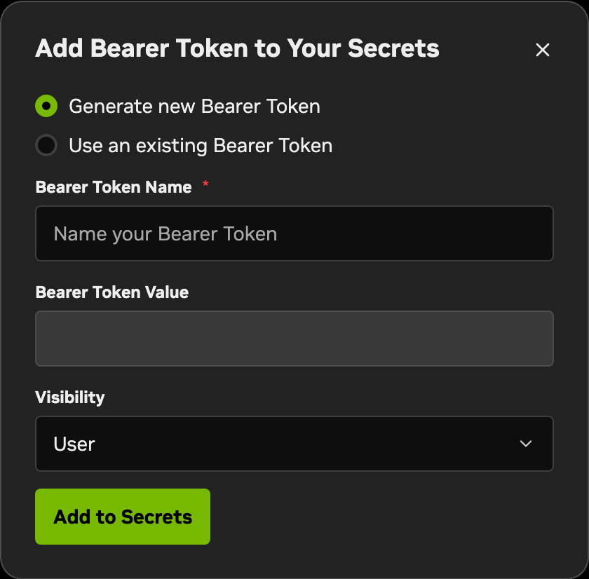
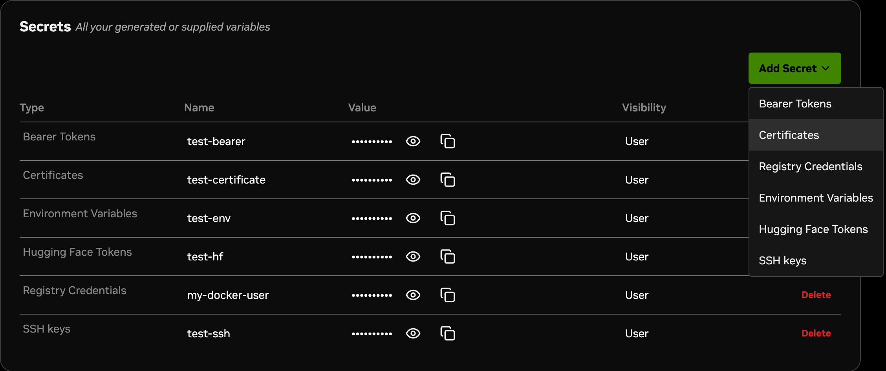

The **Secrets** page in the NVIDIA CCluster console lets you create and manage `Bearer Tokens`, `Certificates`, `Registry Credentials`, `Environment Variables`, `Hugging Face Tokens`, and `SSH keys`. These were previously called Vault objects.
This guide will walk you through creating `Bearer Tokens` and other secrets you can use to configure or access NVIDIA CCluster services.

<Note>
Bearer tokens saved in Secrets protect your deployed inference endpoints — clients include them in requests to your General Inference and Dynamo endpoint URLs. For **platform API automation** (SDK, CLI, deployment management without browser login), use [Service Accounts](/resources/service-accounts) instead.
</Note>

## Step 1: Log in to the NVIDIA CCluster
You will need to log in to the NVIDIA CCluster to manage secrets. If you do not yet have access, contact your NVIDIA representative or your organization's designated support contact before proceeding.

Once logged in, select **Secrets** from the sidebar menu.

<Frame>
    
</Frame>


Once completed, move onto the second step below based on the type of secret you are creating. 

## Step 2A: Creating bearer tokens

Bearer tokens can be used to access NVIDIA CCluster services.

To generate a bearer token, select **Add Secret**. A dropdown menu will appear. From that menu, select the `Bearer Tokens` option.


<Frame>
    
</Frame>

A window named `Add Bearer Token to Your Secrets` will pop up. From there, you can either name and automatically generate a token with the `Generate new Bearer Token` option or you can enter a previous token using the `Use an existing Bearer Token` option.

<Frame>
    
</Frame>

Once you either enter your token in the text box or opt into generating your token, choose a **Visibility** (see below) and click **Add to Secrets**. Your bearer token appears in the **Bearer Tokens** list.

<Frame>
    
</Frame>


## Step 2B: Adding certificates
NVIDIA CCluster uses client certificates for [mutual TLS (mTLS)](https://www.cloudflare.com/learning/access-management/what-is-mutual-tls/)
You can generate or add public certificates for mTLS just like you can with Bearer Tokens. Once you generate the certificate, it appears in the **Certificates** list.

<Frame>
    
</Frame>

<Frame>
    
</Frame>

<Frame>
    
</Frame>

When generated, certificates download a `.pem` file to your local browser. That `.pem` file is named after the generated cert. You can then use that `.pem` file to access one of NVIDIA CCluster's [secured endpoints](/resources/private) as long as they are associated with the appropriate certificate and `.pem` pair.


<Frame>
    
</Frame>


### Example usage

```bash showLineNumbers={false}
curl -X POST 'https://centml-private-2.fe178792.c-09.centml.com/openai/v1/chat/completions' \
  --cert gen-cert.pem \
  -H 'Accept: application/json' \
  -H 'Content-Type: application/json' \
  -d '{
    "messages": [
      {
        "role": "user",
        "content": "what is the meaning of life?"
      }
    ],
    "model": "meta-llama/Llama-3.2-3B-Instruct",
    "max_tokens": 512,
    "n": 1,
    "presence_penalty": 0,
    "stream": true,
    "stream_options": {
      "include_usage": true
    },
    "temperature": 0.7,
    "top_p": 1
  }'

```

### Adding your own certificates
This section is currently under construction as we work to improve the UX around adding certificates to endpoints on the NVIDIA CCluster. Please check back soon! 


## Step 2C: Adding registry credentials

Registry credentials allow the NVIDIA CCluster to pull container images from private registries when creating [General Inference](/apps/inference), [Compute](/apps/compute), or [Batch Jobs](/apps/jobs) deployments.

To add registry credentials, select **Add Secret** and choose `Registry Credentials` from the dropdown. Enter a name, along with the registry username and password (or access token). The credentials are stored securely and can be selected as **Image Registry Credentials** during deployment configuration.

Supported registries include Docker Hub, Amazon ECR, Google Artifact Registry, Azure Container Registry, and any Docker-compatible private registry. CCluster automatically detects the registry from the image URL at deployment time.


## Step 2D: Adding environment variables

Select **Add Secret**, choose `Environment Variables`, and enter the variable name and value. When you configure a deployment, you can select a saved environment variable instead of typing its value.


<Frame>
    
</Frame>

<Frame>
    
</Frame>

 


## Visibility and lifecycle

- **Visibility** — each secret is visible either to you (`User`) or to your organization (`Organization`). The Secrets table shows the visibility of each secret. A secret name must be unique per type and visibility.
- **Secrets are immutable** — you cannot edit a secret after you create it. To rotate a value, create a new secret and update your deployments to use it, then delete the old one.
- **Deleting is blocked while in use** — you cannot delete a secret that the selected revision of any deployment still references, including paused deployments. Switch those deployments to another secret first.
- **Deployments reference secrets** — deployments store a reference to the secret rather than a copy of its value, so you pick Hugging Face tokens, registry credentials, bearer tokens, and environment variables from Secrets when you configure a deployment.

## What's next

<CardGroup cols={3}>
  <Card
    title="General Inference"
    icon="fa-solid fa-circle-nodes"
    href="/apps/inference"
  >
    Deploy protected endpoints for your own containers and models.
 </Card>
  <Card
    title="Securing Endpoints"
    icon="fa-solid fa-lock"
    href="/resources/private"
  >
Learn how to protect your endpoints with Bearer tokens and mTLS certificates
 </Card>
  <Card
    title="Clients"
    icon="fa-solid fa-terminal"
    href="/clients/setup"
  >
    Learn how to interact with the NVIDIA CCluster programmatically
  </Card>
</CardGroup>
