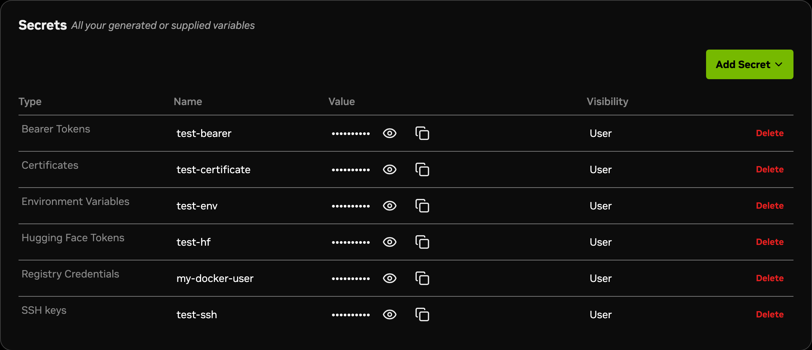
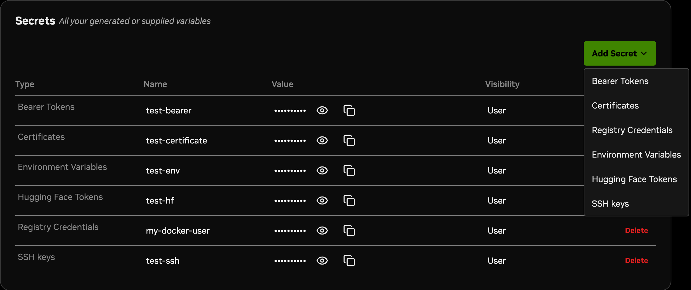
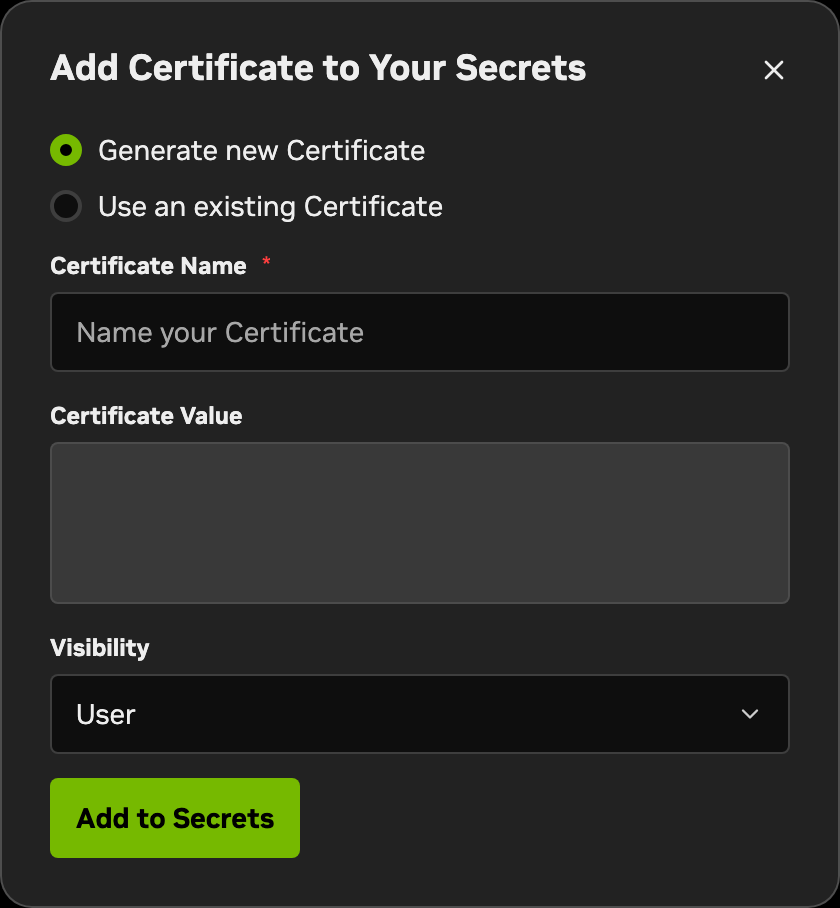
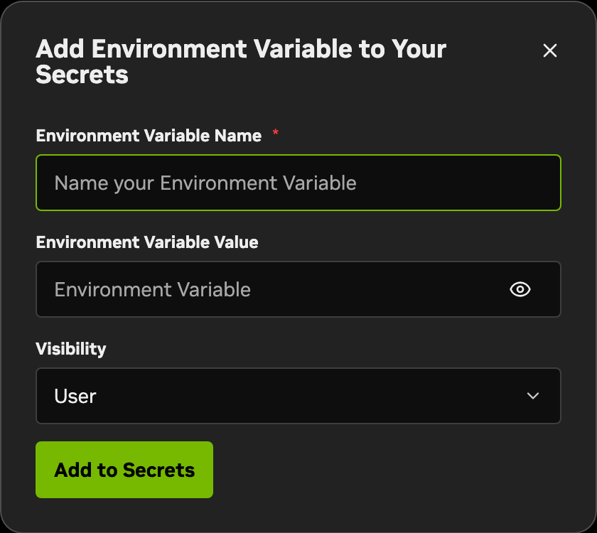

The **Secrets** page in the NVIDIA CCluster console lets you create and manage `Bearer Tokens`, `Certificates`, `Registry Credentials`, `Environment Variables`, `Hugging Face Tokens`, and `SSH keys`. These were previously called Vault objects.
This guide will walk you through creating `Bearer Tokens` and other secrets you can use to configure or access NVIDIA CCluster services.

<Note>
Bearer tokens saved in Secrets protect your deployed inference endpoints — clients include them in requests to your General Inference and Dynamo endpoint URLs. For **platform API automation** (SDK, CLI, deployment management without browser login), use [Service Accounts](/resources/service-accounts) instead.
</Note>

## Step 1: Log in to the NVIDIA CCluster
You will need to log in to the NVIDIA CCluster to manage secrets. If you do not yet have access, contact your NVIDIA representative or your organization's designated support contact before proceeding.

Once logged in, select **Secrets** from the sidebar menu.

<Frame>
    
</Frame>


Once completed, move onto the second step below based on the type of secret you are creating. 

## Step 2A: Creating bearer tokens

Bearer tokens can be used to access NVIDIA CCluster services.

To generate a bearer token, select **Add Secret**. A dropdown menu will appear. From that menu, select the `Bearer Tokens` option.


<Frame>
    
</Frame>

A window named `Add Bearer Token to Your Secrets` will pop up. From there, you can either name and automatically generate a token with the `Generate new Bearer Token` option or you can enter a previous token using the `Use an existing Bearer Token` option.

<Frame>
    
</Frame>

Once you either enter your token in the text box or opt into generating your token, choose a **Visibility** (see below) and click **Add to Secrets**. Your bearer token appears in the **Bearer Tokens** list.

<Frame>
    
</Frame>


## Step 2B: Adding certificates
NVIDIA CCluster uses client certificates for [mutual TLS (mTLS)](https://www.cloudflare.com/learning/access-management/what-is-mutual-tls/)
You can generate or add public certificates for mTLS just like you can with Bearer Tokens. Once you generate the certificate, it appears in the **Certificates** list.

<Frame>
    
</Frame>

<Frame>
    
</Frame>

<Frame>
    
</Frame>

When generated, certificates download a `.pem` file to your local browser. That `.pem` file is named after the generated cert. You can then use that `.pem` file to access one of NVIDIA CCluster's [secured endpoints](/resources/private) as long as they are associated with the appropriate certificate and `.pem` pair.


<Frame>
    
</Frame>


### Example usage

```bash showLineNumbers={false}
curl -X POST 'https://<endpoint_url>/v1/chat/completions' \
  --cert gen-cert.pem \
  -H 'Accept: application/json' \
  -H 'Content-Type: application/json' \
  -d '{
    "messages": [
      {
        "role": "user",
        "content": "what is the meaning of life?"
      }
    ],
    "model": "meta-llama/Llama-3.2-3B-Instruct",
    "max_tokens": 512,
    "n": 1,
    "presence_penalty": 0,
    "stream": true,
    "stream_options": {
      "include_usage": true
    },
    "temperature": 0.7,
    "top_p": 1
  }'

```

### Adding your own certificates
If you already have a certificate authority (CA), you can use it instead of generating a certificate.

1. On the **Secrets** page, select **Add Secret** and choose `Certificates`.
2. Select **Use an existing Certificate**.
3. Enter a name and paste the full certificate value (PEM format) of your CA into **Certificate Value**.
4. Select **Add to Secrets**.

The certificate then appears in the **Certificates** list. Select it under **Private Endpoint** when you create a deployment, and clients that present a certificate signed by your CA can reach the endpoint. No `.pem` file is downloaded, because you already hold the client certificate and key.


## Step 2C: Adding registry credentials

Registry credentials let CCluster pull private container images. Save credentials in **Secrets** for reuse in [General Inference](/apps/inference) and [Compute](/apps/compute) deployments. [Batch Jobs](/apps/jobs) accept credentials directly in the deployment form.

### Save registry credentials

1. Obtain login credentials from your container registry. Use a password or access token with permission to pull the image.
2. In CCluster, open **Secrets → Add Secret → Registry Credentials**.
3. Complete the form:

   | Field | What to enter |
   | --- | --- |
   | **Registry username** | The registry login username. Some registries require a special username when authenticating with an access token; see the NGC example below. |
   | **Password or access token** | The raw password or token, not Docker config JSON. |
   | **Visibility** | **User** for personal use, or **Organization** to share credentials within your CCluster organization. |

4. Click **Save credentials**. Saving stores the credentials; it does not verify authentication or access to a particular image.

**Registry username** is used to authenticate, not as a friendly name for the saved entry. The form's info icons explain the fields. The **setup guide** link in the opening paragraph opens this section.

### Example: NVIDIA NGC (`nvcr.io`)

Create an [NGC API key](https://org.ngc.nvidia.com/setup/personal-keys) with access to the container image you want to pull. See NVIDIA's [NGC authentication guide](https://docs.nvidia.com/ngc/latest/ngc-user-guide.html) for key types and permissions. When saving the credentials, use:

| Field | What to enter for NGC |
| --- | --- |
| **Registry username** | `$oauthtoken` — enter this literal text, including the dollar sign, without quotes. |
| **Password or access token** | Paste the raw NGC API key. |

For NGC, do not use your NVIDIA email, organization name, or `nvcr.io` as the username. For example, for image `nvcr.io/nvidia/pytorch` and tag `26.01-py3`, the registry is inferred from the image URL. You still use `$oauthtoken` as the username; `nvidia` is the image namespace.

### Use saved credentials in a deployment

Choose **Image pull authentication → Registry credentials**. In General Inference, select the entry under **Saved registry credentials**. In Compute, select the saved entry in **Registry username**; its password is filled automatically.

You can also select **Create registry credentials** from the General Inference or Compute form. This opens a new tab and keeps your unfinished deployment open. Save the credentials, return to the deployment tab, and select **refresh credentials** before choosing the new entry.

If credentials for the same username and visibility already exist, select the existing entry. The current form does not support updating credentials or storing multiple entries with the same username and visibility.

For images that allow anonymous pulls, leave credentials empty. To use a Kubernetes pull secret managed by your administrator, see [Use an existing image pull secret](/resources/custom-image#use-an-existing-image-pull-secret).

## Step 2D: Adding environment variables

Select **Add Secret**, choose `Environment Variables`, and enter the variable name and value. When you configure a deployment, you can select a saved environment variable instead of typing its value.


<Frame>
    
</Frame>

<Frame>
    
</Frame>

 


## Visibility and lifecycle

- **Visibility** — each secret is visible either to you (`User`) or to your organization (`Organization`). The Secrets table shows the visibility of each secret. A secret name must be unique per type and visibility.
- **Secrets are immutable** — you cannot edit a secret after you create it. To rotate a value, create a new secret and update your deployments to use it, then delete the old one.
- **Deleting is blocked while in use** — you cannot delete a secret that the selected revision of any deployment still references, including paused deployments. Switch those deployments to another secret first.
- **Deployments reference secrets** — deployments store a reference to the secret rather than a copy of its value, so you pick Hugging Face tokens, registry credentials, bearer tokens, and environment variables from Secrets when you configure a deployment.

## What's next

<CardGroup cols={3}>
  <Card
    title="General Inference"
    icon="fa-solid fa-circle-nodes"
    href="/apps/inference"
  >
    Deploy protected endpoints for your own containers and models.
 </Card>
  <Card
    title="Securing Endpoints"
    icon="fa-solid fa-lock"
    href="/resources/private"
  >
Learn how to protect your endpoints with Bearer tokens and mTLS certificates
 </Card>
  <Card
    title="Clients"
    icon="fa-solid fa-terminal"
    href="/clients/setup"
  >
    Learn how to interact with the NVIDIA CCluster programmatically
  </Card>
</CardGroup>
